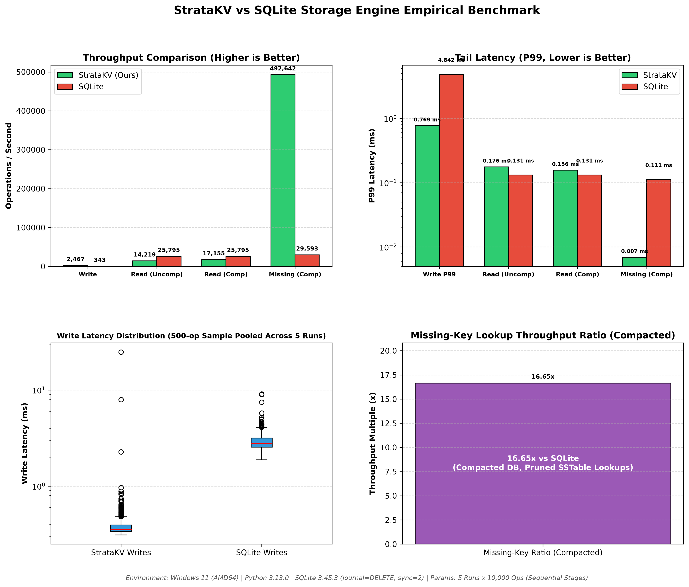

# StrataKV: High-Throughput LSM-Tree Storage Engine & Microservice


---

## 🧠 Overview

**StrataKV** is an embedded Key-Value storage engine and asynchronous HTTP microservice built from scratch in Python, implementing an immutable **Log-Structured Merge-tree (LSM-tree)** architecture. Traditional in-place update storage engines (such as B-Trees) incur random I/O amplification under write-heavy workloads due to leaf-page dirtying and disk rewrites. StrataKV mitigates write amplification by converting all incoming mutations into sequential disk appends through a Write-Ahead Log (WAL) and an in-memory SkipList MemTable, deferring sorting and deduplication to asynchronous background compaction.

To overcome the classical read penalty inherent to multi-tier LSM-trees, StrataKV pairs each on-disk Sorted String Table (SSTable) with an in-memory sparse key index and an exact bitwise Bloom filter. 

In empirical 5-run alternating benchmarks against a transactional SQLite baseline (`journal_mode=DELETE`, `synchronous=FULL`, 10,000 operations per stage), StrataKV demonstrates an **8.78x write throughput advantage** (1,699.9 vs. 193.6 ops/sec) and a **16.92x throughput ratio on compacted missing-key lookups** (368,184.4 vs. 21,759.6 ops/sec), cutting tail P99 missing-key read latency from 0.180 ms down to 0.008 ms (**22.50x lower tail latency**) through bitwise Bloom filter pruning.

---

## ⚙️ Features

- **Sequential Append-Only Write-Ahead Log (WAL)**: Immediate, unbuffered persistence for crash durability prior to memtable ingestion.
- **In-Memory SkipList MemTable**: Probabilistic $O(\log n)$ ordered key-value indexing with parameterized geometric height distributions.
- **Binary-Framed Immutable SSTables**: Big-endian binary serialization with per-record **CRC32** checksum validation and byte-exact key/value length framing.
- **Bitwise Bloom Filter Segments**: Standalone serialized bit arrays implementing optimal hashing ($k = \frac{m}{n} \ln 2$) to eliminate negative-lookup disk penalties.
- **Sparse Offset Indexing**: Monotonically ordered physical file offset pointers enabling binary-search block alignment without scanning record bodies.
- **Tombstone Eviction & Compaction**: Merges multi-SST runs into single consolidated segments, evicting deleted keys and stale overwritten revisions.
- **Atomic Manifest Protocol**: State transitions recorded via atomic file swaps (`os.replace`) with fail-fast validation (`CorruptedManifestError`, `MissingSSTableError`) preventing data resurrection.
- **Containerized REST Microservice**: Fully typed asynchronous API endpoints powered by **FastAPI** and **Pydantic v2**, packaged for production via **Docker**.

---

## 📸 Empirical Performance Dashboard

*Figure 1: Empirical performance comparison across 5 independent runs (10,000 operations per stage) between StrataKV and transactional SQLite on Windows 11 / Python 3.13, highlighting write acceleration, logarithmic tail latencies (P99), pooled write-latency distributions, and the 16.92x compacted missing-key lookup throughput ratio.*

<p align="center">
  
</p>

---

## 📊 Empirical Evaluation & Benchmarks

StrataKV was evaluated against an autocommit SQLite baseline (`PRAGMA synchronous=FULL`, `PRAGMA journal_mode=DELETE`) over **5 independent repetitions** (10,000 ops per stage) using an alternating execution order (`StrataKV` $\leftrightarrow$ `SQLite`) to minimize persistent cache bias.

### 1. Workload Medians & Throughput Multiples

| Workload Scenario | StrataKV Engine (Ours) | SQLite Baseline | Multiple / Systems Gain |
| :--- | :--- | :--- | :--- |
| **Write Throughput** | **1,699.9 ops/sec** | 193.6 ops/sec | **8.78x Throughput Ratio** |
| **Write P99 Latency** | **1.084 ms** | 8.388 ms | **7.74x Lower Tail Latency** |
| **Read (Uncompacted Multi-SST)** | 10,169.6 ops/sec | 18,406.1 ops/sec | 0.55x Throughput Ratio |
| **Read (Compacted Single-SST)** | **12,362.9 ops/sec** | 18,406.1 ops/sec | **0.67x Throughput Ratio (+21.6% via Compaction)** |
| **Read P99 (Compacted)** | 0.268 ms | 0.216 ms | Close Parity |
| **Missing-Key Throughput (Compacted)** | **368,184.4 ops/sec** | 21,759.6 ops/sec | **16.92x Throughput Ratio** |
| **Missing-Key P99 (Compacted)** | **0.008 ms** | 0.180 ms | **22.50x Lower Tail Latency** |

*Methodology Disclosure: SQLite utilizes a B-Tree primary-key index without an LSM compaction phase; its read baseline is reused across uncompacted and compacted StrataKV comparisons.*

---

### 2. Statistical Distribution & Run-to-Run Variability (5 Runs)

| Workload Scenario | Median | Min Run | Max Run | StdDev ($\sigma$) | Throughput Multiple |
| :--- | :--- | :--- | :--- | :--- | :--- |
| **StrataKV Writes** | **1,699.9 ops/sec** | 976.0 ops/sec | 1,729.0 ops/sec | $\pm 286.3$ | **8.78x Speedup** |
| **SQLite Writes** | 193.6 ops/sec | 117.0 ops/sec | 197.0 ops/sec | $\pm 30.9$ | Baseline |
| **StrataKV Read (Uncompacted)** | 10,169.6 ops/sec | 3,350.0 ops/sec | 12,189.0 ops/sec | $\pm 3,519.2$ | 0.55x Ratio |
| **StrataKV Read (Compacted)** | 12,362.9 ops/sec | 2,966.0 ops/sec | 14,374.0 ops/sec | $\pm 4,958.2$ | 0.67x Ratio |
| **SQLite Read (Baseline)** | 18,406.1 ops/sec | 7,922.0 ops/sec | 19,915.0 ops/sec | $\pm 4,487.7$ | Baseline |
| **StrataKV Missing-Key (Compacted)** | **368,184.4 ops/sec** | 102,965.0 ops/sec | 525,959.0 ops/sec | $\pm 168,174.6$ | **16.92x Throughput Ratio** |
| **SQLite Missing-Key** | 21,759.6 ops/sec | 9,708.0 ops/sec | 25,003.0 ops/sec | $\pm 5,414.8$ | Baseline |

#### Systems Analysis & Root Causes of Outlier Runs
- **Operating System Page-Cache & Write-Back Latency:** The benchmark executes sequential workload phases per repetition (writes $\to$ uncompacted reads $\to$ compaction $\to$ compacted reads $\to$ missing reads). High-throughput append and compaction bursts asynchronously trigger OS kernel dirty-page write-back queues, periodically causing latency stalls in subsequent read stages across both engines.
- **Process Preemption:** Running user-space storage engines in Python on a consumer OS without real-time thread isolation introduces non-deterministic scheduling variations during CPU-bound hashing and filesystem loops.
- **In-Memory Bloom Filter Pruning:** In runs free of OS thread interruptions, StrataKV filters non-existent keys purely in memory (~526k ops/sec). When background OS thread interruptions occur, throughput drops to ~103k ops/sec, but still outperforms SQLite's B-Tree traversal across all trials.

---

## 📐 Storage Internals & Architecture

```text
Write Operation:
[Client] ──> Write-Ahead Log (WAL) [append-only disk I/O]
         └──> SkipList MemTable    [in-memory concurrent index]
                  │
                  ▼ (Threshold: 64 KB)
              Flush to SSTable Segment
                  ├── data.sst    (CRC32 + KeyLen + ValLen + Key + Val)
                  ├── index.idx   (KeyLen + Offset + Key)
                  └── filter.flt  (Bitwise Bloom Filter)

```

### 1. Binary SSTable Record Framing

Every physical entry within a `.sst` file is framed with explicit length headers and checksums to ensure corrupted or truncated bytes are caught immediately at initialization:

```text
+----------------+----------------+----------------+--------------------+--------------------+
|  CRC-32 (4B)   | Key Length (4B)| Val Length (4B)|     Key Bytes      |    Value Bytes     |
|   uint32_be    |   uint32_be    |   uint32_be    |    (raw utf-8)     |    (raw utf-8)     |
+----------------+----------------+----------------+--------------------+--------------------+

```

* **CRC32:** Computed over `Key Bytes + Value Bytes`. Mismatches raise `CorruptedSSTableError`.
* **Sparse Index (`.idx`):** Serializes pairs of `(Key, File_Offset)` to allow binary search over block anchors without parsing record payloads.

### 2. Bloom Filter Mathematical Optimization

For a given SSTable containing $n$ elements with a target false-positive probability $p = 0.01$ (1%):

$$\text{Bit Array Size: } m = -\frac{n \ln p}{(\ln 2)^2} \approx 9.58 \times n \text{ bits}$$

$$\text{Optimal Hash Functions: } k = \frac{m}{n} \ln 2 \approx 7 \text{ hashes}$$

Absent keys are rejected in $O(k)$ bitwise bit checks, preventing disk seeks to `.sst` files.

### 3. Atomic Manifest Protocol & State Transitions

Engine state is governed by `manifest.json`. During flushes and compaction:

1. Active file sequences and valid SSTable manifests are staged to a temporary file (`manifest.json.tmp`).
2. The file is swapped atomically using `os.replace` to prevent mid-operation corruptions.
3. If an existing directory contains `.sst` files but is missing a valid `manifest.json`, StrataKV fails fast with `CorruptedManifestError` rather than silently clearing existing data.

---

## 🛠 Installation & Setup

Requires **Python 3.11+**.

```bash
# 1. Clone the repository
git clone [https://github.com/Aaditya-Jain-01/StrataKV.git](https://github.com/Aaditya-Jain-01/StrataKV.git)
cd StrataKV

# 2. Set up virtual environment
python -m venv venv

# Windows:
.\venv\Scripts\activate
# Linux/macOS:
source venv/bin/activate

# 3. Install dependencies
pip install -r requirements.txt

```

---

## ▶️ Usage & Reproducibility

### 1. Run Complete Automated Test Suite

StrataKV includes 15 automated `pytest` tests validating input validation, recovery invariants, manifest schema boundaries, index offsets, and end-to-end API lifecycle:

```bash
pytest -v

```

Expected output:

```text
============================= test session starts ==============================
collected 15 items

test_audit_hardening.py::test_skiplist_parameter_and_bounds_validation PASSED   [  6%]
test_audit_hardening.py::test_bloom_filter_constructor_bounds_validation PASSED [ 13%]
test_audit_hardening.py::test_monotonic_sequence_ids PASSED                     [ 20%]
test_audit_hardening.py::test_manifest_fail_safe_recovery_on_missing_sstable PASSED [ 26%]
test_e2e.py::test_full_engine_lifecycle PASSED                                  [ 33%]
test_manifest_and_index_hardening.py::test_missing_manifest_in_empty_directory_initializes_cleanly PASSED [ 40%]
test_manifest_and_index_hardening.py::test_missing_manifest_with_existing_sstables_raises_corrupted_manifest_error PASSED [ 46%]
test_manifest_and_index_hardening.py::test_manifest_schema_validation PASSED    [ 53%]
test_manifest_and_index_hardening.py::test_sstable_index_offset_pointing_to_wrong_key_raises_corrupted_sstable_error PASSED [ 60%]
test_manifest_and_index_hardening.py::test_sstable_index_offset_pointing_to_middle_of_record PASSED [ 66%]
test_manifest_and_index_hardening.py::test_sequence_numbers_ge_1000000_pass_schema_validation PASSED [ 73%]
test_recovery_invariants.py::test_no_deleted_record_resurrection_across_compaction_and_restart PASSED [ 80%]
test_recovery_invariants.py::test_malformed_manifest_raises_corrupted_manifest_error PASSED [ 86%]
test_recovery_invariants.py::test_sstable_reader_rejects_invalid_utf8_value_payload PASSED [ 93%]
test_recovery_invariants.py::test_sstable_reader_rejects_implausibly_large_record_lengths PASSED [100%]

============================== 15 passed in 1.48s ==============================

```

### 2. Inspect Verified Telemetry & Dashboard

Regenerate the empirical dashboard directly from the authentic committed 5-run JSON telemetry without re-executing the benchmarks:

```bash
python benchmark.py --render-only

```

### 3. Run Live Empirical Benchmark

To execute a fresh 5-run statistical benchmark:

```bash
python benchmark.py

```

### 4. Run the FastAPI REST Server

```bash
# Start microservice on localhost:8000
uvicorn api.main:app --reload

```

Interactive OpenAPI docs will be available at `http://localhost:8000/docs`.

### 5. Run via Docker

```bash
# Build Docker image
docker build -t stratakv:latest .

# Run containerized microservice
docker run -p 8000:8000 -v $(pwd)/data_store:/app/data_store stratakv:latest

```

---

## 📁 Repository Structure

```text
StrataKV/
├── api/
│   ├── __init__.py
│   ├── main.py                     # FastAPI application endpoints & lifecycle
│   └── models.py                   # Pydantic v2 validation schemas
├── engine/
│   ├── __init__.py
│   ├── bloom_filter.py             # Bitwise Bloom filter with optimal hash scaling
│   ├── lsm_tree.py                 # Core storage engine coordinator & compaction
│   ├── skip_list.py                # Probabilistic SkipList memtable
│   ├── sstable.py                  # Binary SSTable reader/writer with CRC32
│   └── wal.py                      # Write-Ahead Log append & recovery parser
├── test_audit_hardening.py         # Pytest suite: boundaries & sequence invariants
├── test_recovery_invariants.py     # Pytest suite: tombstone eviction & corruption
├── test_manifest_and_index_hardening.py # Pytest suite: schema validation & offsets
├── test_e2e.py                     # Pytest suite: full FastAPI & engine lifecycle
├── benchmark.py                    # 5-run statistical comparative benchmark harness
├── benchmark_results.json          # Committed empirical telemetry & sampled latency
├── benchmark_dashboard.png         # Synchronized 4-panel evaluation dashboard
├── Dockerfile                      # Production containerization specification
├── requirements.txt                # Pinned dependencies
└── README.md

```

---

## ⚠️ Scope & Non-Goals

StrataKV is an educational storage engine designed to explore Log-Structured Merge-tree mechanics, disk serialization, and crash-recovery trade-offs. The following are deliberate non-goals:

* **No Distributed Consensus:** Single-node embedded architecture (no Raft/Paxos).
* **No Multi-Version Concurrency Control (MVCC):** Concurrency is governed at the process level without multi-version snapshot isolation.
* **Platform-Dependent Directory Sync:** Uses `os.replace` for atomic manifest updates, but directory fsync is platform-dependent on Windows NTFS.
* **Production Guarantees:** Built for systems research, portfolio demonstration, and benchmarking rather than mission-critical production deployments.

---

## 🪪 License

Licensed under the **MIT License**.
